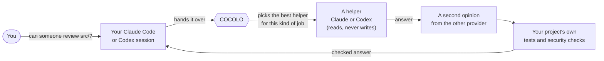
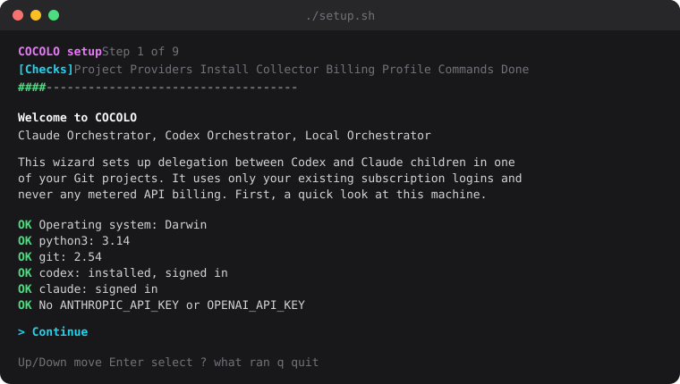
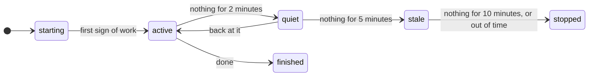
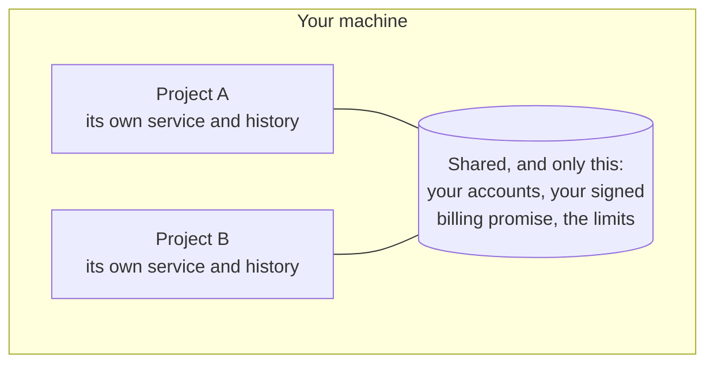

# COCOLO

**Claude Orchestrator, Codex Orchestrator, Local Orchestrator**

[](https://github.com/Lyderies/cocolo/actions/workflows/ci.yml)
[](LICENSE)

You're deep in a Claude Code or Codex session and you'd love a second pair of eyes: someone to
review that change, dig through the docs, or sketch a plan, while you keep going.

COCOLO is that second pair of eyes. Your session hands the job over, COCOLO picks a helper (Claude or
Codex, whichever is best at that kind of job), keeps an eye on it while it works, has the answer
checked, and hands it back. All on your own machine, all on the subscriptions you already pay for.
No API keys, no surprise bills.

> **Status:** 0.3.2. Made on a Mac; Linux works too, except operational QA, which still needs macOS. Windows, sadly, no.

## How a job travels



The choice of helper follows fixed rules, written down in a [routing table](docs/routing-table.md):
quality first, then whatever uses the least of your allowance. No AI gets to pick its own favourite.

## Getting started

You'll need a Mac (or Linux), Git, Python 3.11 or newer, and Claude Code and/or the Codex CLI, signed
in with your subscription. COCOLO works with Claude Code 2.1 and Codex CLI 0.164 to 0.169.

Clone this repository somewhere that isn't inside one of your projects, then:

```sh
./setup.sh /path/to/your/project
```



The wizard does the fiddly parts: it checks your machine, asks which helpers you'd like, installs
into your project, and asks you to sign a one-line promise that your accounts can't be billed beyond
their subscriptions. Arrow keys and Enter get you through. Press `?` whenever you want to see what
just happened, and `q` to leave. Run it again any time to update, check, or re-sign.

A project you haven't set up before needs one small file naming its test and security commands.
The [recipe](docs/manual-setup.md#operational-checks) takes about five minutes, and
[getting started](docs/getting-started.md) walks you through the whole first run.

## Then just ask

Open your project and ask in plain words:

- **Claude Code:** "Use the `agent-orchestration` skill to have the routed reviewer check the error
  handling in `src/`."
- **Codex:** start `codex` in the project's own folder (from your own terminal) and ask for the
  `orchestrate-agents` skill.

Your session does the rest and tells you what came back. If something gets refused, the answer says
why and what to do about it, and nine times out of ten the fix is "run `./setup.sh` again".
[Using it](docs/using-it.md) has more examples.

> [!CAUTION]
> Open Codex on the project's own folder, never on a folder full of projects, on this repository,
> on your home folder or on `/`. A session opened too high up could change files that run outside
> Codex's sandbox. [Here's why](docs/security-model.md#where-to-open-codex).

## COCOLO keeps an eye on every helper

Helpers are separate programs COCOLO starts and watches, so you can always ask how one is doing, or
stop it. It also notices when one has wandered off:



Quiet isn't a crime: helpers think, too. But ten minutes of silence, or running past its time limit,
and the helper is stopped, along with anything it started.

## Several projects at once

Each project gets its own little service with its own history, so two projects can each have a
helper working at the same time without waiting on each other, or peeking at each other's work.



## The ground rules

- **Your subscriptions, nothing else.** No helper starts until you've signed that your accounts can't
  be charged extra. An API key in your terminal, an unknown client version, or billing that looks paid
  or unclear: everything stops.
- **Helpers look, they don't touch.** Every helper is read-only and only sees the committed files it
  was given.
- **You hold the pen.** Only you can sign, with your own key, and setup runs this repository's code,
  never your project's.

The [security model](docs/security-model.md) has the exact rules, and the honest list of known limits.

## Want to know more?

- [Getting started](docs/getting-started.md): from a fresh clone to your first review
- [Using it](docs/using-it.md): asking for help from Claude Code and from Codex
- [Setup wizard](docs/setup-wizard.md): every step and every choice
- [How it works](docs/how-it-works.md): the machinery, for the curious
- [Troubleshooting](docs/troubleshooting.md) and the [FAQ](docs/faq.md)
- [Everything else](docs/README.md)

## What's next

Helpers that can edit files, each in its own copy of your project, are planned for 0.4.0. What
changed in each release lives in the [CHANGELOG](CHANGELOG.md).

## Contributing, security and license

- [CONTRIBUTING.md](CONTRIBUTING.md): how to help. Anything touching safety or billing gets an
  independent security review.
- [SECURITY.md](SECURITY.md): found a vulnerability? Please report it privately, not in an issue.
- [Apache License 2.0](LICENSE), see [NOTICE](NOTICE).
