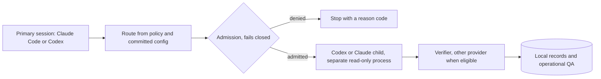
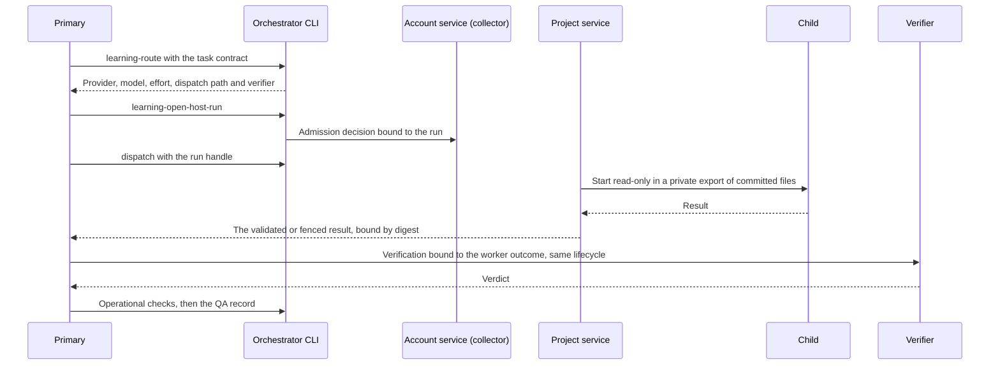

# How it works

This page explains what COCOLO does when you ask for help, from the route to the records it keeps.

## Terms

- The **primary** is the session you work in: Claude Code or Codex.
- A **child** is an agent the primary delegates one bounded assignment to.
- **Admission** is the deterministic gate that decides whether a child may start.
- The **ledger** is the local record that binds each run to its route, admission decision and result.
- The **verifier** is a second child that checks a meaningful result, from the other provider when one
  is eligible.
- **Operational QA** runs your project's own hashed test and security commands.
- A **project service** is a small local process, one per project, that runs that project's children
  and keeps its history.
- The **collector** is the one local service shared by every project on the machine. It holds the
  account-level records: which provider accounts were seen and attested, admission decisions and how
  many children are running.

## The flow

In words: the primary asks for a route, admission either stops the run or admits one read-only child, and
the result goes to a verifier (from the other provider when one is eligible), then to the records and QA.

## Routing

A route is a pure function of the installed policy, the task contract and your project's committed
configuration. It names the provider, model, effort, dispatch path and verifier. The order comes from
the [routing table](routing-table.md): quality first, then expected usage cost per finished task. Model
output never grants tools, paths or spend, and the table changes only when recorded evidence justifies
it; COCOLO never changes its own routing without you. Which providers and Claude models children may
use is set per project in `provider-routing.json` (see [configuration](configuration.md)).

## One run, step by step

In words: route, open (admission), dispatch one child, record exactly the result it returned, verify it
through the same lifecycle, then run operational QA. From either primary, every child is a separate
read-only process that the project's own service starts, watches and stops.

## Dispatch paths

| Primary | Codex child | Claude child |
|---|---|---|
| Claude Code | `codex exec`, read-only | `claude -p`, read-only |
| Codex | `codex exec`, read-only | `claude -p`, read-only, only if the project allows it |

- **Every child is a separate process** ("bridged"), from either primary. No child shares the primary's
  session, its permissions or its command rule, and every child can be watched and stopped from
  outside. A Claude primary's Claude children are no longer Claude Code subagents.
- **Children run in a private export** of the committed bytes of their granted paths, under a hard
  deadline. The bridge validates the result, fences one that does not validate or is too large to
  keep, and records a keyed digest of what it returns, never its text.
- **A Codex primary reaches Claude children** only when the project sets
  `codex_primary_may_bridge_to_claude` and the session was started with `codex -p orchestrator`, the
  profile that turns sandbox network on. Ordinary Codex sessions keep network off.

## One service per project

Each project has its own service. It starts on demand, runs that project's children and keeps that
project's history. Normal commands talk to the project's service and to the account service in the
collector; they do not open the shared ledger or pause the collector.

- **Projects run at once.** One project's child, registration, provider observation or owner
  attestation does not wait for or stop another's.
- **Separation.** Only the session that started a run can see or stop it, and one project never sees
  another's runs.
- **Your terminal.** Setup, `learning-status` and the billing attestation run in your own terminal,
  outside any Codex or Claude Code session. Your terminal may read status and observe providers, but
  nothing that starts work or spends usage.
- **Verification needs the service.** Verification and operational QA of a result go through the
  project's service. It keeps what a verifier needs only while it runs: it stops after fifteen idle
  minutes, or twelve idle hours when it holds recorded results, and when the project is updated.
- **A stopped service.** If a project's service stops while a child is claimed, that run is reported
  as unavailable, never as an outcome, and new runs proceed.
- **An old service.** A project service left running by an earlier version is replaced when no child
  is running (`project_service_other_version` until then).

## Run health

While a child runs, `learning-run-status` reports its health: `starting`, `active`, `quiet` (no new work
for two minutes), `stale` (five minutes), then `stopping` or `terminal`. `learning-cancel-run` requests
a stop. Replayed, blank or other-model frames do not count as work.

The project's service stops a child by itself when:

- it shows no validated start within three minutes, or no new work for ten minutes;
- it reaches its hard deadline (the route's time limit, at most six hours);
- its client starts in an invalid way, it uses a prohibited tool, or the client reports a paid or
  rejected rate-limit event (immediately; Claude children run with partial message streaming so these
  are seen as they happen).

These liveness thresholds are provisional and not yet calibrated against real client timings. A stopped
child is never retried automatically.

## Capacity

- **On the machine:** at most two children run at once, and at most two per provider account. These
  installed limits are deliberately conservative for this release; no request can raise them. A child
  that cannot get a place is refused with `claim_busy`.
- **Per project:** a project's service prepares up to four children. A refused run frees its share.
  A child's place is given back only once every process it started has stopped, including one that
  detached from its tree: each child carries a run marker in its environment, and the place is held
  while any process still carries it or is still in the child's session.
- **Per usage window:** admission also keeps a run cap per provider usage window, whatever headroom
  says.
- **After a crash:** when a project's service stops or crashes while its run holds a place, the
  project's next service settles that run by itself, usually within seconds of its child ending: the
  run ends abandoned with an unknown outcome and its place is freed. It does so only on positive
  evidence from the operating system that the child, everything left in its process group and
  session, and its deadline watchdog are gone, that the watchdog confirmed before exiting that
  every process it tracked had stopped (or that the run never started a child), and that no process
  still carries the child's run marker (see the [security model](security-model.md#what-it-does-not-protect-against)),
  and never while any of it may still run. The account takes that settlement on the project
  service's own evidence (its result lease and storage evidence); it cannot check the kernel itself.
  That is within your own same-user trust boundary, and a stronger, generic reconcile is planned for
  0.4.0. A watchdog that was killed before it could confirm leaves the run to the
  timed rule below. A service that is stopped normally does the same for its own runs
  before it exits. When that evidence is missing or cannot be read, or the service crashed in the
  instant between starting the child and its watchdog taking over, the place is freed one hour after
  the run's hard deadline, measured on both the wall clock and the run's own monotonic clock. The next
  service starts with the project's next command.

## Runs that cannot launch

A run that can never launch closes by itself, with no command. When the account denies a claim (stale
billing, for example), the account fences it, its result space and preparation are freed, and `dispatch`
gives the denial's reason. A run that failed before its claim was sent frees them the same way. A claim
refused without a receipt, or whose reply was lost, is settled by the account's claim fence: if the
account admitted the claim the run keeps everything; otherwise the fence makes sure it can never be
admitted, and the run closes the same way. If the account refuses the fence itself, the service asks
again, waiting longer each time (from one second up to five minutes, ten tries in all), and keeps the
run's result space and preparation meanwhile. If no try is answered, the run gives its preparation back
so the project can still prepare others, and its place at the account is freed by the timed rule. The orchestration can then close and the next child launches.
Called anyway, `learning-classify-host-run-abandoned` answers `already_closed`.

## The records and replay

- **Account-level records** (provider accounts observed and attested, admission decisions, how many
  children are running) go to a local ledger in `~/.local/state/codex-agents`, shared by every project on
  the machine through the collector.
- **Each project's own history** (its runs, results, QA and what it learned from them) lives in that
  project's store beside it, owned by the project's service. After an update from 0.2.x, a project's
  earlier learning history moves from the shared ledger to its store by itself on first use, when no
  child is running.
- **Learning** (case mining, analysis, inert proposals) runs on each project's own history after a
  result or its QA is recorded. It never changes routing by itself.
- Neither is ever committed, and every recorded route replays exactly.

### How long records are kept

Raw events from Codex and Claude hooks are most of a busy project's records, so each event code has a
weight in the installed policy `config/retention-policy.json`:

| Weight | Kept | Event codes |
|---|---|---|
| Low | 7 days | `tool_started`, `tool_output_observed`, `hook_completed`, `usage_snapshot`, `item_completed`, `turn_started`, `turn_stop_observed` |
| Medium | 30 days | `session_started`, `session_ended`, `turn_completed`, `turn_failed`, `turn_interrupted`, `subagent_started`, `subagent_stop_observed`, `model_rerouted` |
| High | 90 days | `no_progress`, `retry`, `repair`, `escalation` |

The host's own lifecycle events (a child starting, stopping) are kept as long as their run's outcome, 90
days, and outcomes, cases, feedback and QA keep their own retention. The collector removes expired raw
events by itself, a small batch every minute. Before it removes them, it writes one summary per run and
day (how many of each event code, first and last seen, and the span between), kept 90 days, so the totals
outlive the raw rows. It leaves alone any event a record link, a stored file, a grant or an attestation names, and your backups, which
keep their own lifetime: an expired event can stay inside a backup until that backup expires.
`learning-expire` still applies all of the ledger's retention, lineage included, when you run it. A period
applies from when an event is recorded, so records an earlier version kept keep the expiry they were given.

Commands that need the shared ledger to themselves (backup, owner-key replacement, migration and similar)
refuse while any child is running instead of stopping the collector under it.

A Codex primary reaches the collector through the Codex commands rule, which runs a protected copy of the
orchestrator outside Codex's sandbox; see the
[security model](security-model.md#the-protected-copy-and-the-codex-rule).

## Where the code lives

The internal names below predate the name COCOLO and are kept as they are.

| Path | Contents |
|---|---|
| `setup.sh` | The setup wizard |
| `scripts/install.py`, `scripts/attest.py` | The installer and the billing attestation |
| `packages/codex-agents/` | The orchestration package: agents, skills, hooks, routing, contracts, the services, the learning ledger and operational QA |
| `packages/claude-agents/` | The Claude agent package: roles, contracts, validation, the installer, and the stream and usage parsers |

[`packages/README.md`](../packages/README.md) describes the two packages and where they came from.
