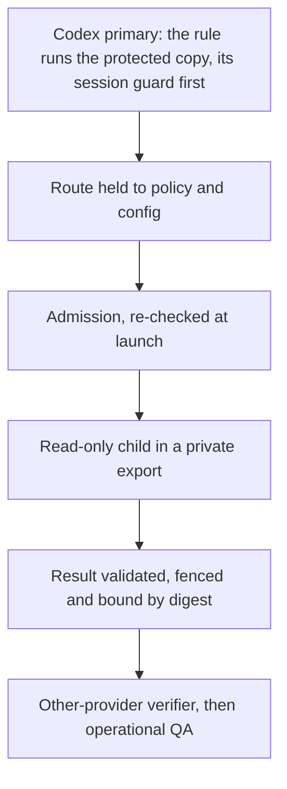

# Security model

This page explains what COCOLO release 0.3.3 (Codex package 0.8.24) protects, how, and
what it does not protect against. It is the exact version of the README's "Safety, in short". It is for users deciding whether to run it and for
contributors changing it. To report a vulnerability, follow [SECURITY.md](../SECURITY.md).

## Threat model

- **The agents run as you.** The AI agents this sets up run as your user account, so the setup tools
  and the orchestrator assume an agent may have changed anything it can write: the temporary folders,
  and any folder a Codex session was opened on, which may be a project or a folder above it (a nested
  project's tree, `.git` and `.claude` included).
- **Text is data, not authority.** Repository text, tool output and model output never grant
  providers, models, tools, paths or spend. Deterministic code and your project's committed
  configuration decide those, and a child's grant can only narrow its parent's.
- **No per-command approvals.** The orchestrator runs without asking you to approve each command.
  Safety comes from redundant layers instead, and a failure at any layer stops the run.
- **Billing is the other asset.** Nothing may reach a metered API, usage credits or paid fallback.

In words: a request meets these layers in order, and a failure at any layer stops the run.

## Where to open Codex

The supported setup assumes every Codex session is opened on a project itself, and that this
repository (the orchestrator clone) sits outside every folder opened in Codex. Never open Codex on a
folder that contains a set-up project, on this repository, on your home folder, on a folder above it
or on `/`, and never add `~`, `~/.codex` or `~/.local` with `--add-dir`.

A folder above a project is never safe. Codex runs a nested trusted project's `.codex/config.toml` and
hooks outside the sandbox, and keeps a project's `.codex`, `.agents` and `.git` read-only only when the
project is the top of the session's folder, so a session opened above it could plant those files. A
session that can write your home folder or `~/.codex` could change the Codex rule, its protected copy
and tools installed under your home folder, which the rule then runs.

## What COCOLO enforces

- **Subscription only.** Admission fails closed on an API key in the environment, an unreviewed client
  version, an identity or billing reading over 30 minutes old, a non-subscription plan, a missing
  attestation, unknown or paid-usage billing, exhausted headroom (90% of a window) or a run cap, and
  re-checks at launch.
- **Reviewed client versions only.** The installed routing policy admits Claude Code from 2.1.0 up to,
  not including, 2.2.0, and Codex CLI from 0.164.0 up to, not including, 0.170.0. Codex 0.164.0 was
  checked live; for 0.169.0 the launch surface was compared without a model call, and the live
  containment check on 0.169.0 is part of this release's real-install trial. The release is not to be
  published with that range unless the check passes; otherwise the upper bound goes back to 0.164.1.
  Widening the range needs the same comparison and a live containment check first.
- **Owner-signed attestation.** Per account in each project, you sign that extra usage and credit
  purchases are off, with your one passphrase-protected owner key. `attest.py` signs only the bytes it
  rebuilt from your answers, keys without a passphrase are refused, and signing runs without `ssh-agent`,
  so no program, an AI agent included, can use your key to sign in your name. The attestation is your
  own statement about your billing settings: admission also checks what the clients report, but relies
  on extra usage and Codex credit purchases being off, so re-attest whenever they change. See
  [what the owner key does not stop](#what-the-owner-key-does-not-stop).
- **Signatures are checked in a confined helper.** The account service checks each owner signature with
  `ssh-keygen` in a separate helper that cannot start another process, open a network connection or
  write outside its private working folder. On macOS that is a `sandbox-exec` policy. On Linux the helper
  confines itself before it reads any input: a seccomp filter refuses new processes and sockets (required;
  only x86_64 and arm64 are supported, and the helper refuses to start otherwise), and Landlock refuses
  writes elsewhere on Linux 5.13 or later. An older kernel without Landlock keeps the process and network
  limits only.
- **Read-only children in a private export.** A bridged child sees only the committed bytes of its granted
  paths, under a hard deadline. Claude children get `Read`, `Glob` and `Grep` only. Codex children run
  `codex exec` read-only and ephemeral, without user config, execpolicy rules, approvals or connectors.
  Every child is bridged, from either primary; none runs inside the primary's session. Each is watched
  by its project's service and stopped on silence, at its deadline, on a prohibited tool or on a paid or
  rejected rate-limit event ([run health](how-it-works.md#run-health)).
- **Capacity limits.** At most two children run at once on the machine and per provider account, and
  no request can raise those installed limits ([capacity](how-it-works.md#capacity)).
- **Your terminal cannot start work.** Commands from your own terminal, outside a Codex or Claude Code
  session, may read status and observe providers, but cannot start work or spend usage.
- **Results bound in the ledger.** `dispatch` fences an invalid result and binds a digest of the one it
  returns. QA accepts only the verifier opened for that outcome and runs only the project's hashed
  commands.
- **Claude primaries cannot run owner commands through Claude Code's tools.** The installer adds deny
  rules for every owner-only CLI subcommand to the project's `.claude/settings.json`, plus `Edit` rules for
  `.codex/**`, `.agents/**`, `.claude/settings*.json` and `.git/**`. These are a policy layer on Claude
  Code's tools, not a sandbox.

## What the owner key does not stop

The passphrase protects your key; it cannot stop a program swapping in a different key. The ledger records
the enrolled key, and a signer file that does not match is refused: nothing is signed, and every billing
statement stops counting, because each signature is checked against the current key. That applies when a run
opens and when a child launches. A replaced key cannot be made current again.

- "Replace a lost owner key" cannot ask for the old key, since that is what was lost. Nothing proves
  cryptographically who replaced it, as at first setup. The new key's date shows in the wizard's menu and in
  `learning-status`, so a replacement you did not make can be seen.
- Replacing a key cancels billing statements and grants not yet used. QA, calibrations and promotions the
  old key approved stay in force, so after a stolen key review those yourself.
- A sandboxed Codex session cannot write your records (see the session guard). A Claude primary has no
  sandbox: deny rules cover the commands, edits to `~/.local/state/codex-agents` and shell commands naming
  it, but they are a policy layer that another spelling can miss, and they name only that default folder, not
  an `XDG_STATE_HOME` one. A program running as your user with no sandbox could edit the ledger and the
  signer file together, or run the replacement itself, and a ledger whose key history was emptied enrols
  whatever the signer file then holds. Nothing in your user account can prevent that.
- The record starts from the signer file the first time a ledger opens after a key is enrolled, or after
  updating to this version, so it cannot catch a change made before then.

## The protected copy and the Codex rule

Codex's sandbox blocks the learning collector, so a Codex primary needs the optional Codex commands
rule, which you allow in step 8 of the [setup wizard](setup-wizard.md). The rule lets only the 27
everyday orchestrator commands run outside Codex's sandbox.

- The rule does not run the project's own `cli.py`, which a session opened above the project could
  rewrite. Setup copies exactly this package's runtime files, verified byte for byte, to an owner-only
  `~/.codex/agent-orchestration/<project digest>/<runtime digest>/` folder bound to the project, and the
  rule names that copy.
- The copy runs only the everyday commands, and only while the project's runtime files are byte for byte
  the copy. Before its folder goes on the import path, it checks that it holds exactly the files its
  manifest lists, so a planted module is never imported.
- Every Python the rule, the collector and the hooks start runs with `-I -B -S -X pycache_prefix=/dev/null`,
  so nothing from the working folder, the environment, site-packages or a bytecode cache loads.
- The rule works only in your account's real `~/.codex`; a `HOME` or `CODEX_HOME` that disagrees with
  the system account database, or a symlinked `~/.codex`, is refused. After a Python upgrade or a package update, `host-command` reports the
  rule as `stale` until setup runs again.

## The session guard

Before each command the rule runs, the protected copy reads the calling Codex session's own record (only
its settings, never the conversation) and refuses a session that:

- runs without its sandbox, or left no record (`--ephemeral`);
- was opened on a folder that contains the project;
- can write `/`, your home folder or a folder above it, `~/.codex`, this repository, your records in
  `~/.local/state/codex-agents`, the private working folders or a tool folder (`~/.local`,
  `/opt/homebrew` and the like, including one added with `--add-dir`).

The record format is Codex 0.164's, and any change fails closed. In a Codex session, `host-command` prints
the verdict as `session_guard`, and the Codex skill stops on anything but `ok`. Because the guard runs
before every rule-matched command, `dispatch` included, a session that could write the bridge's files
never starts a child. A refused session's commands stop, but what it already wrote stays.

The wizard's first screen also scans Codex's session records from the last 14 days and warns about a
session that could write this repository, your records or your home folder, or that was opened on a
folder containing a set-up project.

## Trusted installation folders

The interpreter the rule names (and its standard library), every provider client and Git must resolve
to a real file in a trusted installation folder: system folders, Homebrew, python.org, the Command Line
Tools, `/Applications`, Nix, or a hidden top-level folder of your home folder such as `~/.pyenv` or
`~/.local`. They must also be owned by you or root, writable by no one else, outside the project and the
temporary folders, and never macOS's `/usr/bin/python3` shim or `/usr/bin/git` shim. It is an allowlist
rather than "outside the home folder", because a sibling such as `~/Work/tools` could be part of a
permitted session's workspace. The owner tools and the runtime use one list, and setup never runs a
client or basic tool from an earlier `PATH` entry.

## Where your records live

- Your orchestrator records (the ledger, the digest key, the owner key record and the collector's files)
  live in `~/.local/state/codex-agents`, with the home folder taken from the system account database.
  They are never committed.
- `XDG_STATE_HOME` moves them only when it points inside a hidden folder of your home, such as
  `~/.local/state`; any other value refuses every command.
- Every existing folder between your home folder and the records must be a real folder, yours and
  writable by no one else, and the checked state files refuse a second hard link.
- Earlier releases kept the records in `~/Library/Application Support/codex-agents` on macOS. Setup
  moves them once, only with your approval, after showing when that folder was created and which owner
  key it names. Until then every orchestrator command refuses.
- A result that needs verification is kept only while its orchestration is open, and at most seven days
  after its outcome was recorded. Afterwards only the outcome's digests and closed metadata stay. In
  practice the project's service holds what a verifier needs only while it runs (up to twelve idle
  hours).
- Each project's own history is kept in its store under the records folder
  (`projects/<project id>`), owned by the project's service.

How the setup tools keep your authority away from the agents (trusted Python, Git plumbing only, the
owner key only from your own `~/.ssh`) is described in the
[setup wizard reference](setup-wizard.md#how-setup-keeps-your-authority-away-from-the-agents).

## What it does not protect against

These are accepted limits of this release. A report that shows one is worse than documented is welcome.

- **Codex reads.** Codex's read-only sandbox can read outside the export; enforced read roots come
  with the later milestone that adds children working in their own worktrees (G3).
- **A session that already writes `~/.codex`** (opened on `/`, or given it with `--add-dir`) can forge its
  own session record, the rule and the protected copy. The guard stops the ordinary mistake, not that. A
  session opened on a trusted installation folder itself could change the tools there too.
- **Parent-folder sessions.** A session opened above the project is refused by the guard, but can still
  change the project's `.codex` (its hooks and `config.toml`), `.codex/orchestration` and `.git/config`
  directly; the orchestrator refuses that session's commands, but cannot undo what it wrote.
- **A primary that ignores its route.** Routed children are always separate processes, but a primary
  can still bypass COCOLO: a Codex primary can spawn its own native Codex subagent, which shares its
  rule, and a Claude primary can spawn its own Claude Code subagents. Those are outside admission and
  spend the primary's own allowance.
- **Other spellings and detached processes.** The installer's Claude Code deny rules are a policy layer,
  so a command spelled another way (such as `bash -c`) is not matched. The process tracker polls, so a
  descendant that detaches (starts its own session) while its parent exits between two snapshots is
  never seen as part of the child's tree. Every child therefore carries a fresh, unguessable marker in
  its environment (`COCOLO_RUN_TAG`), which its descendants inherit, and a child's place is not given
  back while any of your processes started since the child still carries it, or is still in the
  child's own session. A process whose environment cannot be read at all (a setuid `login`, say) is
  judged by the nearest readable parent it inherited its environment from; one detached under
  launchd/init with no such parent holds the place. What is still not found: a process that clears or rewrites its own
  environment, or, on macOS, runs one of Apple's own system tools (such as `sh` or `sleep`, whose
  environment macOS hides from other processes), and that also starts a new session and detaches
  between snapshots. Such a process can outlive cleanup; it stays inside the child's read-only,
  network-disabled sandbox. When a process that could have carried the marker ends before a check
  reads it, the check lists your processes again, so one that forks and exits mid-check cannot hide
  what it started; processes ending under an ordinary parent (a busy build, say) do not hold it up. On Linux two more cases apply,
  because a process can make its own environment unreadable (`PR_SET_DUMPABLE`): such a process
  started during a run and detached (an `ssh-agent`, say) holds that run's place until it exits, and
  a marked process that does this and is adopted by a parent other than systemd (a container's init,
  say) is not found. macOS is not affected by these two.
- **Settling a lost service's run.** The account accepts a project service's settlement of a lost run
  (`account.settle_lost_run`) on that project's own evidence, its result lease and storage evidence;
  the account cannot check the kernel itself. Each project service runs as you, so this is within the
  same-user trust boundary. A stronger, generic reconcile is planned for 0.4.0.
- **Prompt content and a modified package.** Repository text, and your own `AGENTS.md` and Codex skills,
  reach a child's prompt as instructions (never as authority). The protected copy is checked against
  this package, not against a signature: an owner who installs a modified package gets that package
  copied.
- **Sessions running during an install.** The learning hooks run the project's installed hook code, not
  the protected copy, outside the sandbox. Once installed, that code is protected like
  `.codex/hooks.json` itself, but not from a process that was already writing the project before the
  install, when `.codex` did not exist. Close every Codex session in the project before installing or
  updating.
- **Claude settings and skills.** A Codex session in the project can rewrite `.claude/settings*.json`
  (hooks, deny rules) and `.claude/skills/`, which Claude Code loads on the host; verify warns about
  hooks there.
- **The old macOS records.** A session that could write `~/Library` could have changed them before the
  move; you check their creation date and owner key before approving it. The old copy
  (`codex-agents.moved-<time>`, with the digest key) stays readable until you delete it.
- **Raw results on disk.** A kept worker result is owner-only but readable by any sandboxed session, as
  all host files are, while its orchestration is open (at most seven days).
- **Warnings, not checks.** The wizard's session scan follows only the last 14 days of records. The
  `XDG_STATE_HOME` check trusts `HOME`, your own environment, as its anchor.
- **Platform gaps.** On macOS the interpreter check accepts folders the `admin` group can write, as
  Homebrew and python.org install that way. The per-user cache folder and the records folder were
  verified unwritable only in Codex 0.164's macOS sandbox; `$XDG_RUNTIME_DIR` on Linux was not tested
  live.
